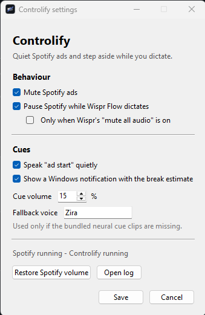
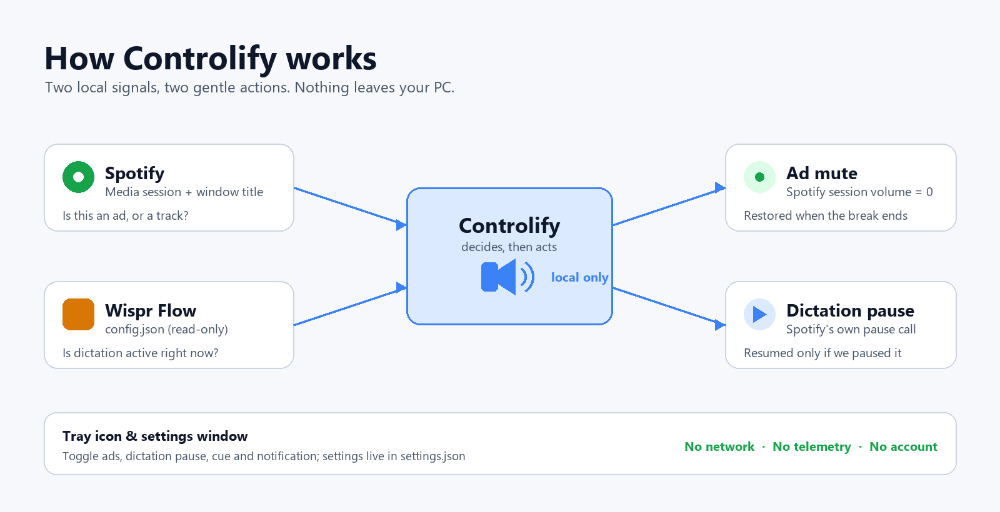

# Controlify

Controlify is a small Windows utility for the Spotify desktop app. It does two
things:

1. **Ad muter** - when Spotify plays an ad, every Spotify audio session is set to
   volume 0 (only Spotify, never the system volume). The previous volume is
   restored when the ad ends, and remembered in `state.json` so a crash can't
   leave Spotify silent.
2. **Pause while dictating** - when Wispr Flow starts dictating, Spotify is
   paused (via its own media session, not a global media key), and resumed
   afterwards. It only resumes if Controlify paused it and you haven't touched
   playback since.
   This happens on *any* dictation, whatever Wispr's own *Mute all audio while
   dictating* switch says - so your other audio keeps playing while only
   Spotify stops. `--pause-needs-wispr-setting` goes back to following
   Wispr's switch.
   * If an ad is playing when you start dictating, Spotify is **not** paused.
   * If the ad ends mid-dictation, Spotify is paused as soon as the song starts,
     and resumed after dictation (once the ad-mute volume has been restored).

Ad muting works with Spotify alone. The dictation feature additionally needs
[Wispr Flow](https://wisprflow.ai/) installed. Controlify is an unofficial
personal project; see [Disclaimer](#disclaimer).

## Screenshots

## Requirements

* **Windows 10 or 11** (tested on Windows 11) - Controlify uses Windows
  media-session, per-app audio, microphone, and toast-notification APIs. It
  does not run on macOS or Linux.
* **Python 3.9+** (3.10+ recommended; tested on 3.14), installed from
  [python.org](https://www.python.org/downloads/) with **Add python.exe to
  PATH** ticked.
* **Spotify desktop app**, Free or Premium (the Microsoft Store version should
  work too). Ad muting only matters on Free; the dictation pause works on both.
* Optional: **Wispr Flow**, only for the pause-while-dictating feature.

The tray icon needs `pystray` and `Pillow`; `setup.bat` installs both. Without
them (or with `--no-tray`) everything else still works, just without the tray.

## Quick start

1. Install Python 3 as described above.
2. Double-click **`setup.bat`**. It creates a local `.venv` and installs the
   dependencies (it needs an internet connection for PyPI). From a terminal,
   `setup.bat --dev` also installs the test tools.
3. Double-click **`run.bat`** to try it with a visible console, or
   **`run-hidden.vbs`** to run it in the background. A tray icon appears while
   Controlify runs; right-click it for settings.
4. Optional: install autostart (see below) so it starts at logon.

No config file is needed. The first run creates `controlify.log` and, as
needed, `state.json` and `settings.json`; all are machine-specific and are
excluded from git. Keep the folder somewhere writable (not `C:\Program Files`),
because those files and the cached cue clips are written next to the script.

## Run

    .venv\Scripts\python.exe controlify.py -v     (or run.bat)   visible, Ctrl+C to stop
    run-hidden.vbs        background, no window: a tiny watcher starts Controlify
                          when Spotify opens; Controlify exits when Spotify closes
    settings.bat          open the settings window (works while Spotify is closed)
    stop.bat              stop everything for now (also disables autostart
                          and restores Spotify's volume if an ad was muted)

Log: `controlify.log` (every Spotify metadata change and whether it counted as
an ad, each ad break's measured ads and lengths, plus dictation events). Flags:
`--no-ads`, `--no-pause`, `--no-announce`, `--no-notify`, `--no-tray`,
`--poll 0.15`, `--pause-needs-wispr-setting`, `--fix-default-mic`,
`--wispr-config PATH` (default `%APPDATA%\Wispr Flow\config.json`),
`--settings` (open the settings window and exit), `--version`, and `--restore`
(put Spotify's volume back from `state.json` and exit, useful after a crash).

## Autostart

Run PowerShell in this folder and use

    powershell -ExecutionPolicy Bypass -File .\install-autostart.ps1

Undo it with:

    powershell -ExecutionPolicy Bypass -File .\install-autostart.ps1 -Remove

It registers a scheduled task called `Controlify` that starts at logon;
`stop.bat` disables it, so turn it back on with

    powershell -NoProfile -Command "Enable-ScheduledTask -TaskName Controlify; Start-ScheduledTask -TaskName Controlify"

## Tray icon and settings

The tray icon is optional; `setup.bat` installs what it needs. Right-click it
for a menu that mirrors the settings:

* **Mute Spotify ads**
* **Pause Spotify while dictating** and **Only when Wispr's mute setting is on**
* **Speak the ad cue** and **Show ad-break notification**
* **Settings...** (also opens on double-click) for the full window, cue volume,
  and the SAPI fallback voice
* **Restore Spotify volume**, **Open log**, and **Quit Controlify**

**Quit Controlify** stops the app and, when it was started by the watcher, the
watcher and keeper too (otherwise the watcher would just start it again). It
leaves the autostart task enabled, so it comes back at the next logon; use
`stop.bat` to stop it and disable autostart.

Changes apply immediately and are saved to `settings.json` next to
`controlify.py`. The file is plain JSON and is gitignored; you can edit it by
hand while Controlify runs and it will pick up the change within a couple of
seconds. Command-line flags (`--no-ads`, `--no-pause`, `--no-announce`,
`--no-notify`, `--announce-volume`, `--announce-voice`,
`--pause-needs-wispr-setting`) override the saved values for that run only.

The tray belongs to the Controlify process, not the keeper or watcher. In the
recommended `run-hidden.vbs`/autostart setup, Controlify runs only while Spotify
is open, so the tray icon goes away when Spotify closes; use `settings.bat` in
the meantime. Running `run.bat` without `--exit-with-spotify` keeps Controlify
(and the tray) alive regardless of Spotify.

## What's in the folder

| Path | Purpose |
| --- | --- |
| `controlify.py` | The app: detection, muting, pause/resume, watcher, keeper. |
| `ui.py` | Tray icon and tkinter settings window (imported lazily). |
| `setup.bat` / `requirements*.txt` | One-time install; `--dev` adds pytest. |
| `run.bat` / `run-hidden.vbs` | Visible run / background watcher. |
| `settings.bat` | Settings window without starting Controlify. |
| `stop.bat` | Stop everything, disable autostart, restore volume. |
| `install-autostart.ps1` | Scheduled task for logon + restart-on-failure. |
| `clips/` | Bundled cue audio and its licence. |
| `assets/` | App/tray icon. |
| `docs/` | FAQ, screenshots, diagram, asset generators. |
| `tests/` | Self-contained pytest suite. |
| `probe/` | Read-only signal probe for detection work. |

## Staying alive

Three processes, each supervising the one below it:

    keeper (--keep-alive)      started by the scheduled task
      watcher (--watch)        starts Controlify when Spotify opens
        Controlify             mutes ads, pauses for dictation; exits with Spotify

* The tray icon and settings window live in the Controlify process, not in the
  keeper or watcher. See [Tray icon and settings](#tray-icon-and-settings).
* The watcher and keeper both catch every error in their loop, log it and carry
  on, so a hiccup can't silently end them.
* Each of them shows up **twice** in the task manager: `.venv\Scripts\pythonw.exe`
  is a launcher that re-runs the same script with the real interpreter, so
  you see the launcher *and* the interpreter for every level. One keeper,
  one watcher, one Controlify - three levels, six processes.
* `controlify.log` records `keeper started` / `watcher started` / `watcher stopped`.
  If Controlify goes quiet, look for the last of those lines: a `watcher stopped`
  with no cause means something killed it from outside, and the keeper restarts
  it within ~5s regardless.
* A `watcher alive (...)` heartbeat is written every 5 minutes.
* Windows' own "restart on failure" does *not* cover this: a killed process has
  no exit code, so Task Scheduler reports `0xFFFFFFFF` and never retries. The
  keeper exists because of that; a 15-minute trigger is the backstop for the
  keeper itself.

## How it detects things

* Dictation: Wispr Flow's own config says so - `prefs.activeDictationSession` in
  `%APPDATA%\Wispr Flow\config.json` is `null` while idle and holds the running
  session (uuid + start timestamp) while you dictate. It flips within
  milliseconds of the hotkey. Verified during development.
  (This used to be read from the Windows microphone consent store, but Wispr
  stopped being tracked there: the current build writes no consent entry at
  all, so the store stays silent even while dictation runs. The consent store
  is still used as a fallback for builds that don't expose the config key.)
* Setting: `shouldMuteAudio` in `%APPDATA%\Wispr Flow\config.json` (read-only,
  never written). Only consulted with `--pause-needs-wispr-setting`; by
  default any dictation pauses Spotify.
* Ads: Spotify's media session reports "Advertisement" / artist "Spotify" (no
  album), or the metadata has the shape of an ad: **no album at all** and a
  window title that is just the ad's own text instead of "Artist - Track".
  The window rule needs ~0.45s of agreement before it mutes.
  Verified against real ads during development; the test suite uses synthetic
  samples with the same shape (see `tests/test_detect.py`).
* Ad breaks: within a break each ad publishes its own artist + title, so a
  metadata change is where one ad ends and the next starts (confirmed on two
  ticks - at a transition the window and the media session can disagree for
  one). The measured runtimes feed the spoken "how many ads / how long muted"
  estimate described under *Spoken cue*.
* Podcasts: an episode has no artist, the show as its album, and a window title of
  just the episode name, so it looks like that weak ad signal. Episodes are exempt
  from the window rule - otherwise a whole podcast gets muted. A real ad inside a
  podcast still mutes, because it announces itself as "Advertisement".
  The album is what tells an episode from an ad: Spotify publishes every ad
  *without* one, so "no album" means ad. (Vetoing ads because their window
  title happened to equal their title is what let real ads play unmuted.)

## Notes

* Dictation pauses Spotify by retrying for 20s: if the first pause is refused
  (Spotify mid-track) it keeps trying until it sticks. Once you press play
  yourself during dictation, Controlify stops touching playback - it waits
  until the session actually shows the pause, so Spotify's slow status update
  can't be mistaken for you pressing play (that bug left the music paused
  after the dictation ended).
* **Bluetooth quality.** A Bluetooth headset drops from A2DP stereo to
  hands-free (mono, ~8kHz) whenever *its own mic* is opened, and stays there
  while the mic is open - so music sounds bad for exactly as long as you
  dictate, then recovers. Wispr opens the default *communications* mic, which
  can be a Bluetooth headset left over from a call profile. `--fix-default-mic`
  points every mic role at the same device (the console default), so the
  headset is never asked for its mic and stays in stereo. Re-run it if Windows
  changes the defaults again; Controlify logs a warning at the start of each
  dictation while the two disagree. This has nothing to do with muting.
* Wispr's own mute also zeroes Spotify's volume during dictation; Controlify
  re-applies the ad mute if Wispr's restore un-mutes an ad.
* Dictation detection also triggers for Wispr meeting recording (same flag).

## Tests

    setup.bat --dev
    .venv\Scripts\python.exe -m pytest tests

The suite is self-contained and uses synthetic ad/track samples, so it needs
no Spotify, Wispr Flow, or audio device. It covers ad detection, ad-break
prediction, dictation pause/resume, the Wispr config parser, settings
persistence, and the live UI wiring (79 tests).

## Development

`probe/probe.py` is a read-only signal logger for working on detection rules.
It records Spotify's media session, window titles, audio sessions, and Wispr's
config for N seconds:

    .venv\Scripts\python.exe probe\probe.py 60

It writes `probe/probe.log`, which is gitignored. `make_clips.py` regenerates
the spoken cues (see *Spoken cue*), `make_icon.py` regenerates the tray/window
icon, and `docs/make_diagram.py` regenerates the architecture diagram.

Contributions are welcome; see [CONTRIBUTING.md](CONTRIBUTING.md) and the
[FAQ](docs/FAQ.md), and please run the tests before opening a pull request.
For security reports, use [SECURITY.md](SECURITY.md) rather than a public issue.

## Ad notification

When an ad break starts, a silent Windows notification reports it:

> **Ads muted for about 1:30**
> 3 ads, about 30s each

The next break replaces the previous toast, so they don't pile up in the
notification centre. Windows labels it "Controlify" using one registry key
(`HKCU\Software\Classes\AppUserModelId\Controlify`), which is how an
unpackaged app gets a name on a toast. `--no-notify` or the tray's **Show
ad-break notification** switch turns it off.

The count and the length are a prediction, because Spotify only ever exposes
the ad playing right now - never how many are queued or how long the break
runs. So every break is measured as it happens: a change of artist + title is
where one ad ends and the next begins, each ad's runtime is recorded, and the
break's total is recorded when it ends. `state.json` keeps the last
20 breaks, and the next notification is the median of those (an ad under 5s is
treated as a metadata flicker, and a break over 6 minutes as Spotify left
paused mid-ad, so neither skews it). With no history yet it assumes 2 ads of
30s. Practice improves it: after a 1-ad break and a 3-ad break, it predicts 2.

## Spoken cue

Alongside the notification, "ad start" is spoken quietly (or "ad start, not
muted" if the mute didn't take effect). It stays silent while you dictate; the
notification still appears. The two base clips are included in `clips/`; they
were generated offline with Piper (`en_US-ryan-medium`). The voice model itself
is **not** committed because it is ~60 MB and licensed separately - download it
only if you want to regenerate the clips:

    .venv\Scripts\python.exe -m pip install piper-tts
    .venv\Scripts\python.exe -m piper.download_voices --download-dir voices en_US-ryan-medium
    .venv\Scripts\python.exe make_clips.py --voice en_US-ryan-medium

Volume: `--announce-volume 15` (0-100), or the **Cue volume** control in the
settings window; `--no-announce` or the tray's **Speak the ad cue** switch turns
it off. If a clip is missing it falls back to Windows' built-in SAPI voice (Zira
by default; change it in settings), so the app still works without the
neural-voice clips. See `clips/README.md` for the audio licensing details.

## Privacy

Controlify runs entirely on your PC. It makes no network requests, has no
telemetry, and needs no account. It reads:

* Spotify's media session, window title, and per-app audio level, through
  Windows APIs;
* the process list, to find Spotify and Wispr Flow;
* `%APPDATA%\Wispr Flow\config.json` (read-only) if Wispr Flow is installed;
* the Windows microphone consent store as a fallback for older Wispr builds.

It does not modify Spotify or Wispr Flow files.

It writes only `controlify.log`, `state.json`, `settings.json`, and
volume-scaled cue clips, plus one registry key so Windows can label the
notification (`HKCU\Software\Classes\AppUserModelId\Controlify`; remove that key
if you uninstall). The files are gitignored: they are machine-specific, and the
log can reveal what you were listening to. Delete them at any time; Controlify
recreates what it needs.

## Troubleshooting

* **`run.bat` says "No .venv found"** - run `setup.bat` first.
* **Nothing happens when Spotify plays an ad** - check `controlify.log` for
  `spotify:` lines. If they are missing, Spotify may be using a different
  process name or the media session is unavailable; try restarting Spotify.
  Spotify also changes its metadata occasionally; if ads stop being caught,
  run `probe/probe.py` and include the log in an issue.
* **Music is paused but never resumes after dictating** - Controlify only
  resumes playback it paused itself. If you pressed play or pause during
  dictation, it leaves playback alone by design.
* **Dictation never pauses Spotify** - confirm Wispr Flow is installed and its
  config file exists at `%APPDATA%\Wispr Flow\config.json`. Ad muting does not
  need Wispr.
* **Bluetooth audio sounds mono while dictating** - run
  `.venv\Scripts\python.exe controlify.py --fix-default-mic` (see the Bluetooth
  note above).
* **Autostart script is blocked by PowerShell** - run it with
  `powershell -ExecutionPolicy Bypass -File .\install-autostart.ps1`.
* **No tray icon** - run `setup.bat` again (it installs `pystray` and
  `Pillow`), make sure `--no-tray` is not set, and check `controlify.log` for
  `tray icon started`. The app keeps working without the tray.
* **The settings window does not open** - run
  `.venv\Scripts\python.exe controlify.py --settings` from a terminal to see the
  error, or check `controlify.log`. It needs the tkinter module that ships with
  the python.org installer; a stripped-down Python build may omit it.
* **Spotify is stuck at volume 0** - run `stop.bat`, or
  `.venv\Scripts\python.exe controlify.py --restore`. The tray also has
  **Restore Spotify volume**.
* **Settings changes are ignored** - command-line flags override
  `settings.json` for that run. Remove the flag, or restart without it.

## Limitations

* Windows only; it relies on Windows media, audio, and notification APIs.
* Spotify desktop only. It does not control the web player, phones, or Cast
  devices, and it only changes Spotify's own audio session - never system
  volume or other apps.
* Ad detection is heuristic. Spotify can change its metadata at any time; the
  rules in `controlify.py` may need updating when that happens.
* It mutes ads locally. It does not remove ads, skip them, or unlock Premium.
* The tray icon belongs to the Controlify process. In the watcher/autostart
  setup it is visible only while Spotify is open; `settings.bat` covers the
  rest.
* The tray and settings window are optional. If `pystray`, `Pillow`, or
  tkinter is unavailable, the core ad/dictation behaviour still runs.

## Disclaimer

Controlify is an unofficial personal project. It is not affiliated with,
endorsed by, or supported by Spotify or Wispr Flow. Muting ads may conflict
with Spotify's terms of service; check the terms that apply to you and use this
at your own risk. The software is provided "as is", without warranty of any
kind.

## Project

* [FAQ](docs/FAQ.md) - setup, ad detection, dictation, privacy, uninstalling.
* [Contributing](CONTRIBUTING.md) - development setup, tests, pull requests.
* [Security policy](SECURITY.md) - reporting and what the app reads/writes.
* [Changelog](CHANGELOG.md) - what changed in each release.

## License

The code is released under the MIT License (see `LICENSE`). The bundled spoken
cue WAVs in `clips/` were generated with the Piper `en_US-ryan-medium` voice,
whose dataset is licensed
[CC BY-NC-SA 4.0](https://creativecommons.org/licenses/by-nc-sa/4.0/); those
audio files remain under that license. The Piper voice model itself is not
included.
